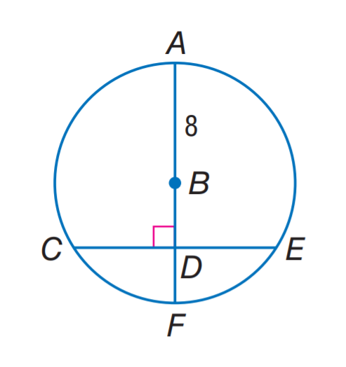

# AVP1458 — Single visual target

MathVista:804 / VisioMath:131_A · different type · Mathematical roles of graphical elements

[Right image in official archive](https://raw.githubusercontent.com/Nefefilibata/VisioMath/4a912153e110001da261917902e1d3cc163b7c6a/data/images.zip) · `images/131_A.jpg`

## Shared or similar visual information

An unfilled circular outline.

## Evidence locations

- Left image: The blue circle through A, C, E and F.
- Right image: The hollow circle at O at the start of the piecewise straight trace.

## Mathematical meanings

Left image: The outline is the circumference centered at B. Right image: The open endpoint excludes the origin from the plotted relation.

## Same mathematical meanings

no

## Rationales

The feature traces the circumference of a geometric circle in the left image and marks an ordered pair excluded from the plotted trace in the right image. The blue circle through A, C, E and F. The hollow circle at O at the start of the piecewise straight trace.

Only the selected target is annotated. AI visual-review draft; not independently double-annotated by humans.
