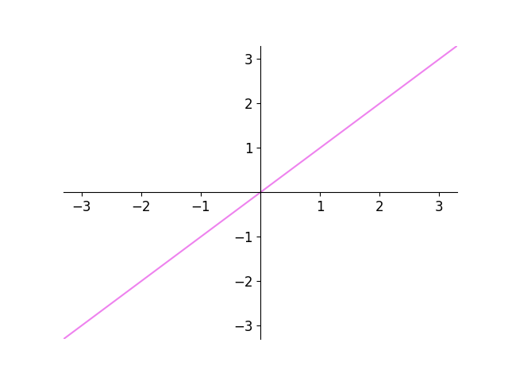

# AVP1459 — Single visual target

DynaMath:106 / VisioMath:538_A · same type · Mathematical roles of graphical elements

[Right image in official archive](https://raw.githubusercontent.com/Nefefilibata/VisioMath/4a912153e110001da261917902e1d3cc163b7c6a/data/images.zip) · `images/538_A.jpg`

## Shared or similar visual information

A solid straight line rising from left to right.

## Evidence locations

- Left image: The magenta diagonal through the origin.
- Right image: The steep rising straight line through O.

## Mathematical meanings

Left image: The trace plots a directly proportional relationship, a linear function through the origin. Right image: The line plots a proportional relationship between the coordinates.

## Same mathematical meanings

yes

## Rationales

In both images the feature plots a linear relationship between coordinates. The magenta diagonal through the origin. The steep rising straight line through O.

Only the selected target is annotated. AI visual-review draft; not independently double-annotated by humans.
