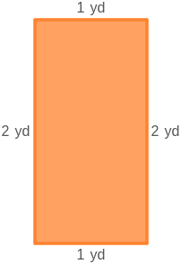
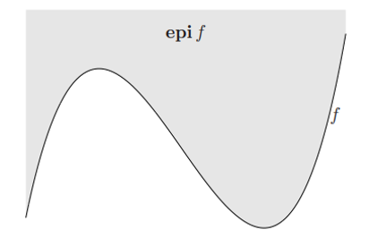

# AVP1464 — Single visual target

MathVista:56 / MathVista:235 · different type · Mathematical roles of graphical elements

## Shared or similar visual information

A shaded region.

## Evidence locations

- Left image: The orange interior of the rectangle labeled 1 yd by 2 yd.
- Right image: The gray region above the curve labeled f and marked epi f.

## Mathematical meanings

Left image: The shading designates the entire planar rectangle whose area is specified by its side lengths. Right image: The shaded region is the epigraph, the set of points with vertical coordinate at least f(x).

## Same mathematical meanings

no

## Rationales

The feature selects a geometric area in the left image and selects the epigraph of a function in the right image. The orange interior of the rectangle labeled 1 yd by 2 yd. The gray region above the curve labeled f and marked epi f.

Only the selected target is annotated. AI visual-review draft; not independently double-annotated by humans.
