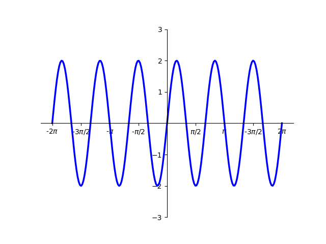
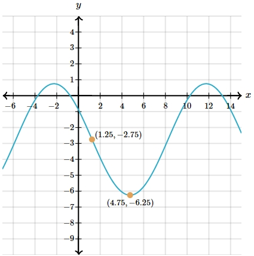

# AVP1467 — Single visual target

DynaMath:1 / MathVerse:540 · same type · Mathematical roles of graphical elements

## Shared or similar visual information

A smooth oscillating curve.

## Evidence locations

- Left image: The blue oscillation of repeated peaks near y = 2.
- Right image: The cyan wave with the labeled trough (4.75, −6.25).

## Mathematical meanings

Left image: The line is the graph of a periodic function repeating the same heights and depths across the x-axis. Right image: The line is a periodic graph, with the labeled coordinates fixing positions on its cycle.

## Same mathematical meanings

yes

## Rationales

In both images the feature traces a repeating function graph. The blue oscillation of repeated peaks near y = 2. The cyan wave with the labeled trough (4.75, −6.25).

Only the selected target is annotated. AI visual-review draft; not independently double-annotated by humans.
