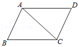

# AVP1472 — Single visual target

MathVista:179 / VisioMath:265_A · different type · Mathematical roles of graphical elements

[Right image in official archive](https://raw.githubusercontent.com/Nefefilibata/VisioMath/4a912153e110001da261917902e1d3cc163b7c6a/data/images.zip) · `images/265_A.jpg`

## Shared or similar visual information

A solid straight line descending from left to right.

## Evidence locations

- Left image: The downward sloping segment AC inside the parallelogram.
- Right image: The falling line crossing each axis at its mark labeled 1.

## Mathematical meanings

Left image: The segment is a diagonal between opposite vertices A and C. Right image: The straight trace graphs a negative-slope linear function.

## Same mathematical meanings

no

## Rationales

The feature connects opposite vertices of a quadrilateral in the left image and plots a linear relationship between coordinates in the right image. The downward sloping segment AC inside the parallelogram. The falling line crossing each axis at its mark labeled 1.

Only the selected target is annotated. AI visual-review draft; not independently double-annotated by humans.
