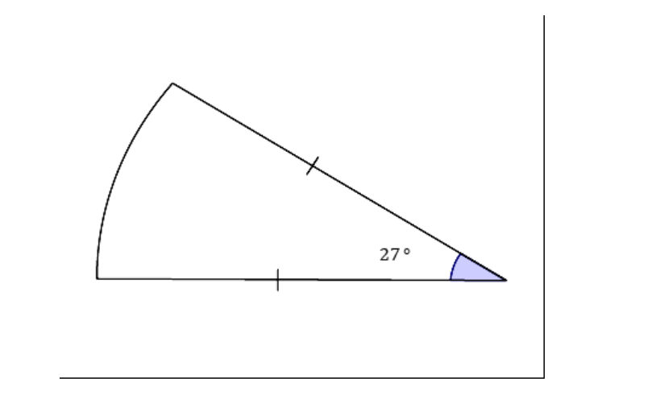

# AVP1474 — Single visual target

MathVerse:413 / VisioMath:413_A · same type · Mathematical roles of graphical elements

[Right image in official archive](https://raw.githubusercontent.com/Nefefilibata/VisioMath/4a912153e110001da261917902e1d3cc163b7c6a/data/images.zip) · `images/413_A.jpg`

## Shared or similar visual information

A shaded region.

## Evidence locations

- Left image: The lavender wedge at the right-hand junction of the two radii.
- Right image: The gray triangle against the baseline of the partitioned rectangle.

## Mathematical meanings

Left image: The shading highlights the 27° central angle between the radii. Right image: The shading selects the triangular subarea with an apex on the top of the rectangle.

## Same mathematical meanings

no

## Rationales

The feature highlights the angle between two rays in the left image and selects a geometric area in the right image. The lavender wedge at the right-hand junction of the two radii. The gray triangle against the baseline of the partitioned rectangle.

Only the selected target is annotated. AI visual-review draft; not independently double-annotated by humans.
