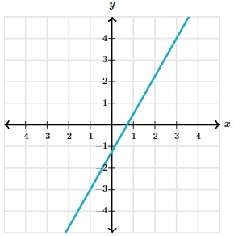

# AVP1475 — Single visual target

VisioMath:1336_A / MathVerse:592 · different type · Mathematical roles of graphical elements

[Left image in official archive](https://raw.githubusercontent.com/Nefefilibata/VisioMath/4a912153e110001da261917902e1d3cc163b7c6a/data/images.zip) · `images/1336_A.jpg`

## Shared or similar visual information

A solid straight line rising from left to right.

## Evidence locations

- Left image: The rising straight line inside the rectangle.
- Right image: The cyan rising straight trace with y-intercept −1.

## Mathematical meanings

Left image: The straight segment is the diagonal connecting the lower-left and upper-right corners. Right image: The diagonal plots a linear function with positive slope.

## Same mathematical meanings

no

## Rationales

The feature connects opposite vertices of a quadrilateral in the left image and plots a linear relationship between coordinates in the right image. The rising straight line inside the rectangle. The cyan rising straight trace with y-intercept −1.

Only the selected target is annotated. AI visual-review draft; not independently double-annotated by humans.
