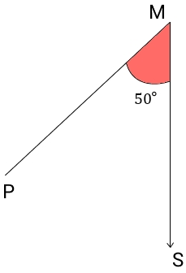
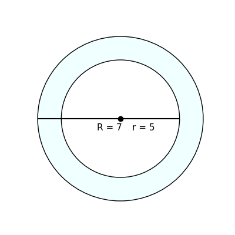

# AVP1477 — Single visual target

MathVerse:332 / DynaMath:53 · same type · Mathematical roles of graphical elements

## Shared or similar visual information

A shaded region.

## Evidence locations

- Left image: The red wedge at M between MP and MS.
- Right image: The light-blue ring between the circles marked R = 7 and r = 5.

## Mathematical meanings

Left image: The shading highlights the 50° angle between MP and MS. Right image: The shading designates the annular area inside the outer circle and outside the inner circle.

## Same mathematical meanings

no

## Rationales

The feature highlights the angle between two rays in the left image and selects a geometric area in the right image. The red wedge at M between MP and MS. The light-blue ring between the circles marked R = 7 and r = 5.

Only the selected target is annotated. AI visual-review draft; not independently double-annotated by humans.
