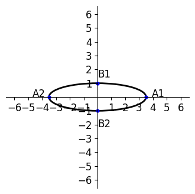

# AVP1478 — Single visual target

DynaMath:176 / VisioMath:288_A · different type · Mathematical roles of graphical elements

[Right image in official archive](https://raw.githubusercontent.com/Nefefilibata/VisioMath/4a912153e110001da261917902e1d3cc163b7c6a/data/images.zip) · `images/288_A.jpg`

## Shared or similar visual information

An oval drawn with an unbroken outline.

## Evidence locations

- Left image: The closed curve through the four vertices, with B1 and B2 at y = 1 and −1.
- Right image: The closed outline of the visible cylinder top.

## Mathematical meanings

Left image: The oval is the plane ellipse with a shorter vertical than horizontal semiaxis. Right image: The oval represents the top circular rim of the cylinder projected into the drawing.

## Same mathematical meanings

no

## Rationales

The feature traces a plane ellipse on the axes in the left image and shows a circular rim of a solid in perspective in the right image. The closed curve through the four vertices, with B1 and B2 at y = 1 and −1. The closed outline of the visible cylinder top.

Only the selected target is annotated. AI visual-review draft; not independently double-annotated by humans.
