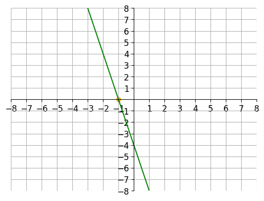

# AVP1479 — Single visual target

DynaMath:109 / VisioMath:643_A · same type · Mathematical roles of graphical elements

[Right image in official archive](https://raw.githubusercontent.com/Nefefilibata/VisioMath/4a912153e110001da261917902e1d3cc163b7c6a/data/images.zip) · `images/643_A.jpg`

## Shared or similar visual information

A solid straight line descending from left to right.

## Evidence locations

- Left image: The green line through the marked point near (−1, 0).
- Right image: The straight trace descending from upper left to lower right through the axes.

## Mathematical meanings

Left image: The straight trace plots a linear function decreasing at a constant rate. Right image: The trace plots a linear function with negative slope.

## Same mathematical meanings

yes

## Rationales

In both images the feature plots a linear relationship between coordinates. The green line through the marked point near (−1, 0). The straight trace descending from upper left to lower right through the axes.

Only the selected target is annotated. AI visual-review draft; not independently double-annotated by humans.
