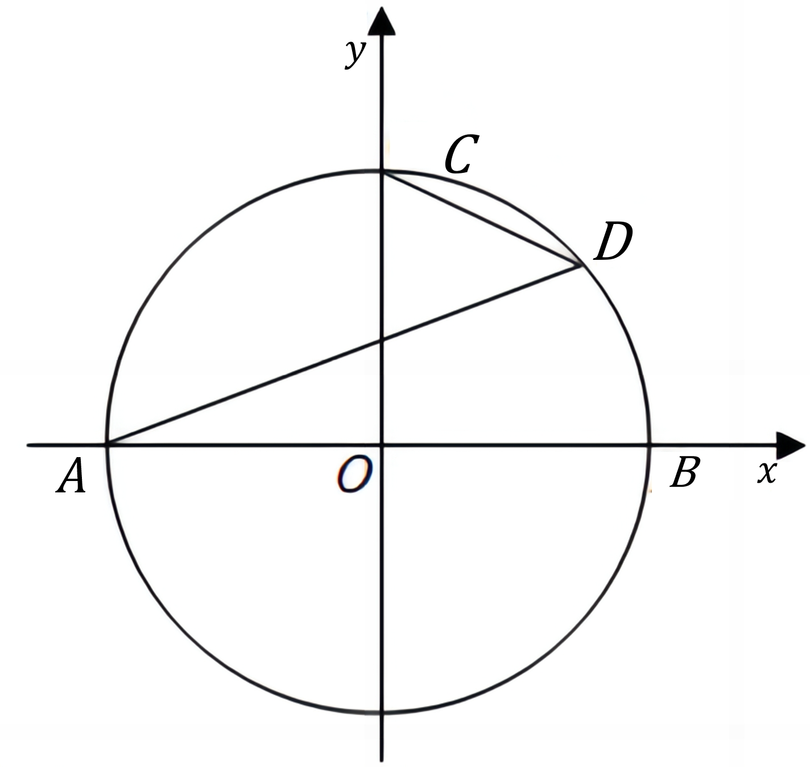

# AVP1480 — Single visual target

DynaMath:55 / VisioMath:1187_A · different type · Mathematical roles of graphical elements

[Right image in official archive](https://raw.githubusercontent.com/Nefefilibata/VisioMath/4a912153e110001da261917902e1d3cc163b7c6a/data/images.zip) · `images/1187_A.jpg`

## Shared or similar visual information

The horizontal coordinate axis.

## Evidence locations

- Left image: The rightward x-axis through O, A and B.
- Right image: The x-axis labeled with −π and π.

## Mathematical meanings

Left image: The axis serves as the horizontal Cartesian reference through the circle’s center. Right image: The axis measures the horizontal Cartesian input to the curve.

## Same mathematical meanings

yes

## Rationales

In both images the feature measures the horizontal Cartesian coordinate. The rightward x-axis through O, A and B. The x-axis labeled with −π and π.

Only the selected target is annotated. AI visual-review draft; not independently double-annotated by humans.
