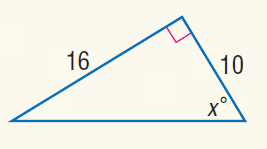

# AVP1481 — Single visual target

MathVista:678 / VisioMath:504_A · different type · Mathematical roles of graphical elements

[Right image in official archive](https://raw.githubusercontent.com/Nefefilibata/VisioMath/4a912153e110001da261917902e1d3cc163b7c6a/data/images.zip) · `images/504_A.jpg`

## Shared or similar visual information

A solid horizontal segment distinct from any axis or gridline.

## Evidence locations

- Left image: The bottom blue side joining the two lower vertices.
- Right image: The flat top of the piecewise graph above the horizontal axis.

## Mathematical meanings

Left image: The horizontal segment is the base and hypotenuse of the displayed right triangle. Right image: The horizontal piece plots constant y during that interval.

## Same mathematical meanings

no

## Rationales

The feature forms a horizontal side of a polygon in the left image and plots a constant function output over an interval in the right image. The bottom blue side joining the two lower vertices. The flat top of the piecewise graph above the horizontal axis.

Only the selected target is annotated. AI visual-review draft; not independently double-annotated by humans.
