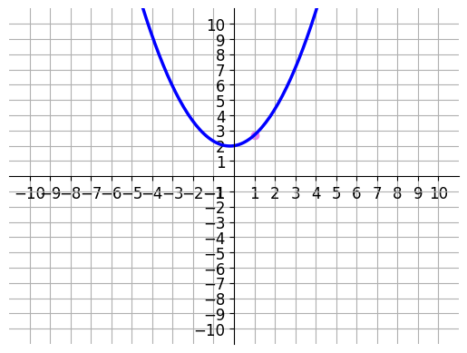
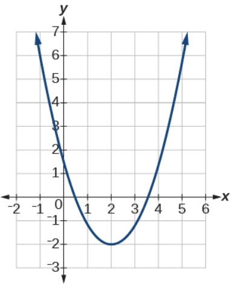

# AVP1482 — Single visual target

DynaMath:105 / MathVerse:500 · same type · Mathematical roles of graphical elements

## Shared or similar visual information

A smooth U-shaped curve.

## Evidence locations

- Left image: The wide blue U-shaped graph with marked points near its minimum.
- Right image: The U-shaped blue trace with its low point at x = 2.

## Mathematical meanings

Left image: The curve plots a function with its minimum at the bottom of the U. Right image: The curve plots a function with a minimum near (2, −2).

## Same mathematical meanings

yes

## Rationales

In both images the feature traces a function that reaches its lowest output at the bottom of the U. The wide blue U-shaped graph with marked points near its minimum. The U-shaped blue trace with its low point at x = 2.

Only the selected target is annotated. AI visual-review draft; not independently double-annotated by humans.
