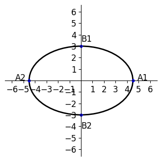
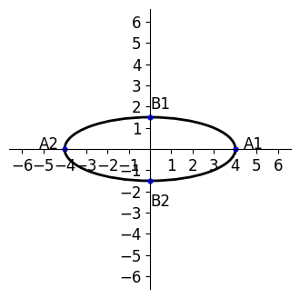

# AVP1484 — Single visual target

DynaMath:175 / DynaMath:177 · same type · Mathematical roles of graphical elements

## Shared or similar visual information

An oval drawn with an unbroken outline.

## Evidence locations

- Left image: The closed curve through A1, A2, B1 and B2.
- Right image: The plane oval through A1 at x = 4 and A2 at x = −4.

## Mathematical meanings

Left image: The oval is the plotted ellipse with horizontal semiaxis 5 and vertical semiaxis 3. Right image: The oval is the ellipse marked with semiaxes along the coordinate axes.

## Same mathematical meanings

yes

## Rationales

In both images the feature traces a plane ellipse on the axes. The closed curve through A1, A2, B1 and B2. The plane oval through A1 at x = 4 and A2 at x = −4.

Only the selected target is annotated. AI visual-review draft; not independently double-annotated by humans.
