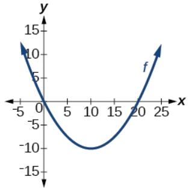
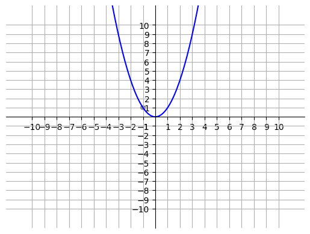

# AVP1488 — Single visual target

MathVerse:496 / DynaMath:46 · same type · Mathematical roles of graphical elements

## Shared or similar visual information

A smooth U-shaped curve.

## Evidence locations

- Left image: The smooth U-shaped dark blue curve labeled f.
- Right image: The blue U-shaped trace near the middle of the grid.

## Mathematical meanings

Left image: The curve graphs a function with its minimum near x = 10. Right image: The curve plots a function whose lowest output is at the bottom of the U.

## Same mathematical meanings

yes

## Rationales

In both images the feature traces a function that reaches its lowest output at the bottom of the U. The smooth U-shaped dark blue curve labeled f. The blue U-shaped trace near the middle of the grid.

Only the selected target is annotated. AI visual-review draft; not independently double-annotated by humans.
