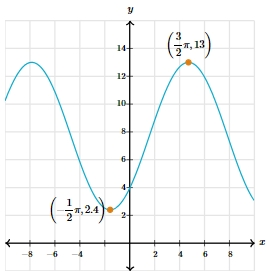
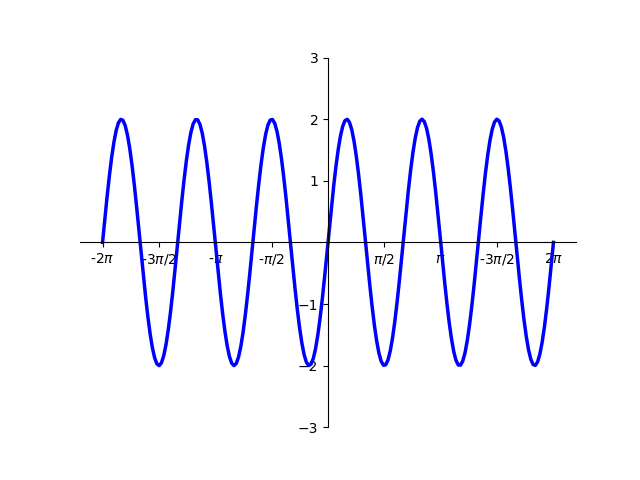

# AVP1492 — Single visual target

MathVerse:536 / DynaMath:1 · same type · Mathematical roles of graphical elements

## Shared or similar visual information

A smooth oscillating curve.

## Evidence locations

- Left image: The cyan wave with marked extrema at (−π/2, 2.4) and (3π/2, 13).
- Right image: The blue oscillation of repeated peaks near y = 2.

## Mathematical meanings

Left image: The trace is the graph of a periodic function whose marked points indicate a trough and a peak. Right image: The line is the graph of a periodic function repeating the same heights and depths across the x-axis.

## Same mathematical meanings

yes

## Rationales

In both images the feature traces a repeating function graph. The cyan wave with marked extrema at (−π/2, 2.4) and (3π/2, 13). The blue oscillation of repeated peaks near y = 2.

Only the selected target is annotated. AI visual-review draft; not independently double-annotated by humans.
