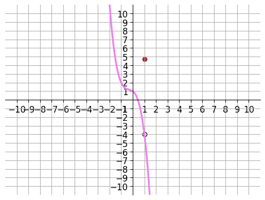
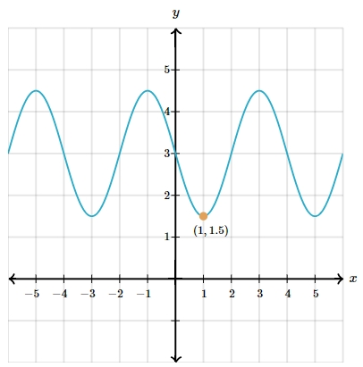

# AVP1493 — Single visual target

DynaMath:143 / MathVerse:541 · same type · Mathematical roles of graphical elements

## Shared or similar visual information

A filled circular point marker.

## Evidence locations

- Left image: The filled red point at x = 1, above the hollow point on the curve.
- Right image: The orange point labeled (1, 1.5) near the bottom of a wave.

## Mathematical meanings

Left image: The dot supplies the function value at the x-coordinate where the smooth trace has a hole. Right image: The dot highlights a particular local minimum on the continuing function curve.

## Same mathematical meanings

no

## Rationales

The feature specifies an isolated included ordered pair off the nearby curve in the left image and identifies a specific point on the interior of the continuing graph in the right image. The filled red point at x = 1, above the hollow point on the curve. The orange point labeled (1, 1.5) near the bottom of a wave.

Only the selected target is annotated. AI visual-review draft; not independently double-annotated by humans.
