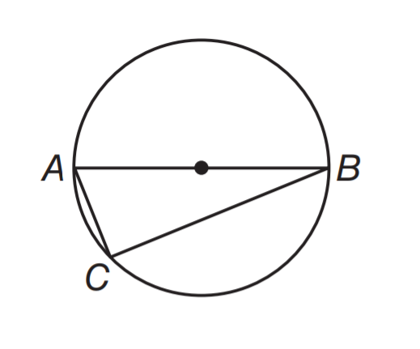

# AVP1494 — Single visual target

VisioMath:510_A / MathVista:28 · same type · Mathematical roles of graphical elements

[Left image in official archive](https://raw.githubusercontent.com/Nefefilibata/VisioMath/4a912153e110001da261917902e1d3cc163b7c6a/data/images.zip) · `images/510_A.jpg`

## Shared or similar visual information

An unfilled circular outline.

## Evidence locations

- Left image: The circular outline touching the three sides of the triangle.
- Right image: The circular outline through A, B and C.

## Mathematical meanings

Left image: The outline is the incircle of the triangle. Right image: The outline is the circumference of the circle whose diameter is AB.

## Same mathematical meanings

yes

## Rationales

In both images the feature traces the circumference of a geometric circle. The circular outline touching the three sides of the triangle. The circular outline through A, B and C.

Only the selected target is annotated. AI visual-review draft; not independently double-annotated by humans.
