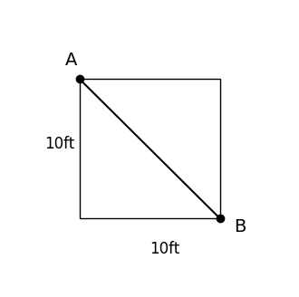
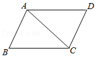

# AVP1496 — Single visual target

DynaMath:80 / MathVista:179 · same type · Mathematical roles of graphical elements

## Shared or similar visual information

A solid straight line descending from left to right.

## Evidence locations

- Left image: The descending segment joining A to B within the square.
- Right image: The downward sloping segment AC inside the parallelogram.

## Mathematical meanings

Left image: The segment is the diagonal joining opposite square vertices. Right image: The segment is a diagonal between opposite vertices A and C.

## Same mathematical meanings

yes

## Rationales

In both images the feature connects opposite vertices of a quadrilateral. The descending segment joining A to B within the square. The downward sloping segment AC inside the parallelogram.

Only the selected target is annotated. AI visual-review draft; not independently double-annotated by humans.
