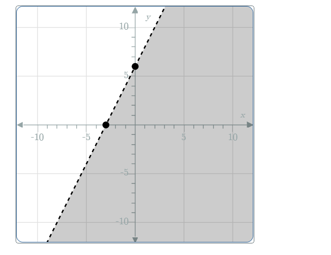

# AVP1497 — Single visual target

MathVerse:511 / VisioMath:612_A · different type · Mathematical roles of graphical elements

[Right image in official archive](https://raw.githubusercontent.com/Nefefilibata/VisioMath/4a912153e110001da261917902e1d3cc163b7c6a/data/images.zip) · `images/612_A.jpg`

## Shared or similar visual information

A shaded region.

## Evidence locations

- Left image: The gray half-plane to the right of the rising dashed boundary.
- Right image: The dark triangular patch crossing the lines of the square assembly.

## Mathematical meanings

Left image: The shaded half-plane is the solution region of a strict linear inequality. Right image: The shading selects the area of the triangle drawn across the assembly.

## Same mathematical meanings

no

## Rationales

The feature selects the solution half-plane of a linear inequality in the left image and selects a geometric area in the right image. The gray half-plane to the right of the rising dashed boundary. The dark triangular patch crossing the lines of the square assembly.

Only the selected target is annotated. AI visual-review draft; not independently double-annotated by humans.
