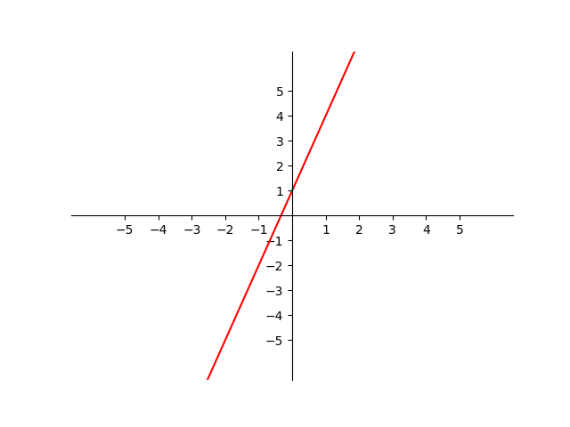

# AVP1499 — Single visual target

DynaMath:15 / VisioMath:492_A · same type · Mathematical roles of graphical elements

[Right image in official archive](https://raw.githubusercontent.com/Nefefilibata/VisioMath/4a912153e110001da261917902e1d3cc163b7c6a/data/images.zip) · `images/492_A.jpg`

## Shared or similar visual information

A solid straight line rising from left to right.

## Evidence locations

- Left image: The red straight line rising from left to right.
- Right image: The rising diagonal crossing the horizontal axis to the right of O.

## Mathematical meanings

Left image: The red trace gives a linear function with positive slope. Right image: The trace is the graph of a positive-slope linear function.

## Same mathematical meanings

yes

## Rationales

In both images the feature plots a linear relationship between coordinates. The red straight line rising from left to right. The rising diagonal crossing the horizontal axis to the right of O.

Only the selected target is annotated. AI visual-review draft; not independently double-annotated by humans.
