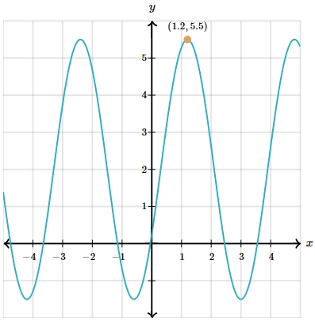

# AVP1502 — Single visual target

MathVerse:481 / MathVerse:531 · same type · Mathematical roles of graphical elements

## Shared or similar visual information

A filled circular point marker.

## Evidence locations

- Left image: The filled cyan point at (1, −4), where the curve ends on the right.
- Right image: The orange point labeled (1.2, 5.5) at the curve’s peak.

## Mathematical meanings

Left image: The dot includes the right endpoint (1, −4) in the function graph. Right image: The dot highlights a particular maximum on the continuing function curve.

## Same mathematical meanings

no

## Rationales

The feature marks an endpoint included in the plotted branch in the left image and identifies a specific point on the interior of the continuing graph in the right image. The filled cyan point at (1, −4), where the curve ends on the right. The orange point labeled (1.2, 5.5) at the curve’s peak.

Only the selected target is annotated. AI visual-review draft; not independently double-annotated by humans.
