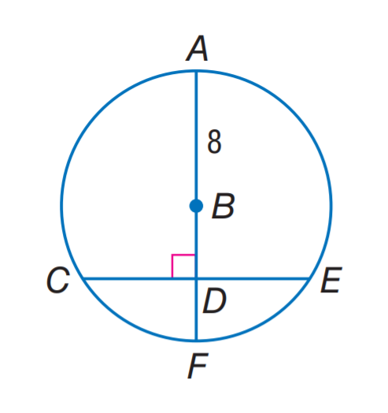
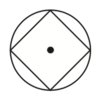

# AVP1505 — Single visual target

MathVista:804 / MathVista:82 · same type · Mathematical roles of graphical elements

## Shared or similar visual information

An unfilled circular outline.

## Evidence locations

- Left image: The blue circle through A, C, E and F.
- Right image: The single outer circle passing through all four corners of the tilted square.

## Mathematical meanings

Left image: The outline is the circumference centered at B. Right image: The outline is the circumcircle of the inscribed square.

## Same mathematical meanings

yes

## Rationales

In both images the feature traces the circumference of a geometric circle. The blue circle through A, C, E and F. The single outer circle passing through all four corners of the tilted square.

Only the selected target is annotated. AI visual-review draft; not independently double-annotated by humans.
