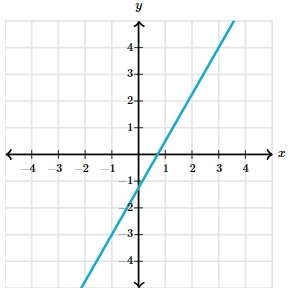

# AVP1513 — Single visual target

MathVerse:592 / VisioMath:107_A · same type · Mathematical roles of graphical elements

[Right image in official archive](https://raw.githubusercontent.com/Nefefilibata/VisioMath/4a912153e110001da261917902e1d3cc163b7c6a/data/images.zip) · `images/107_A.jpg`

## Shared or similar visual information

A solid straight line rising from left to right.

## Evidence locations

- Left image: The cyan rising straight trace with y-intercept −1.
- Right image: The oblique straight trace rising across both coordinate axes.

## Mathematical meanings

Left image: The diagonal plots a linear function with positive slope. Right image: The straight trace gives a linear input-to-output relationship with positive slope.

## Same mathematical meanings

yes

## Rationales

In both images the feature plots a linear relationship between coordinates. The cyan rising straight trace with y-intercept −1. The oblique straight trace rising across both coordinate axes.

Only the selected target is annotated. AI visual-review draft; not independently double-annotated by humans.
