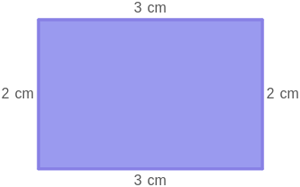

# AVP1514 — Single visual target

MathVista:606 / MathVerse:510 · different type · Mathematical roles of graphical elements

## Shared or similar visual information

A shaded region.

## Evidence locations

- Left image: The lavender rectangle with dimensions 3 cm and 2 cm.
- Right image: The gray half-plane on the right side of the solid oblique boundary.

## Mathematical meanings

Left image: The shading designates the interior area of the rectangle. Right image: The shaded points constitute the solution region on one side of the linear boundary.

## Same mathematical meanings

no

## Rationales

The feature selects a geometric area in the left image and selects the solution half-plane of a linear inequality in the right image. The lavender rectangle with dimensions 3 cm and 2 cm. The gray half-plane on the right side of the solid oblique boundary.

Only the selected target is annotated. AI visual-review draft; not independently double-annotated by humans.
