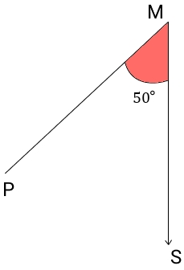

# AVP1518 — Single visual target

VisioMath:413_A / MathVerse:332 · same type · Mathematical roles of graphical elements

[Left image in official archive](https://raw.githubusercontent.com/Nefefilibata/VisioMath/4a912153e110001da261917902e1d3cc163b7c6a/data/images.zip) · `images/413_A.jpg`

## Shared or similar visual information

A shaded region.

## Evidence locations

- Left image: The gray triangle against the baseline of the partitioned rectangle.
- Right image: The red wedge at M between MP and MS.

## Mathematical meanings

Left image: The shading selects the triangular subarea with an apex on the top of the rectangle. Right image: The shading highlights the 50° angle between MP and MS.

## Same mathematical meanings

no

## Rationales

The feature selects a geometric area in the left image and highlights the angle between two rays in the right image. The gray triangle against the baseline of the partitioned rectangle. The red wedge at M between MP and MS.

Only the selected target is annotated. AI visual-review draft; not independently double-annotated by humans.
