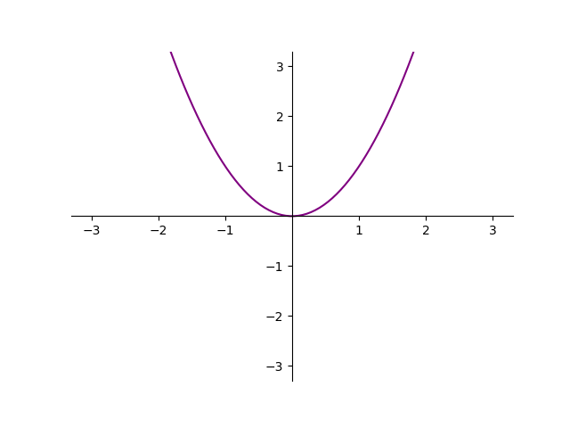

# AVP1524 — Single visual target

DynaMath:52 / VisioMath:16_A · same type · Mathematical roles of graphical elements

[Right image in official archive](https://raw.githubusercontent.com/Nefefilibata/VisioMath/4a912153e110001da261917902e1d3cc163b7c6a/data/images.zip) · `images/16_A.jpg`

## Shared or similar visual information

A smooth U-shaped curve.

## Evidence locations

- Left image: The smooth purple U-shaped trace with vertex at the origin.
- Right image: The U-shaped curve tangent to the horizontal axis at x = −1.

## Mathematical meanings

Left image: The curve plots a function with minimum at the origin. Right image: The curve plots a function with its minimum at (−1, 0).

## Same mathematical meanings

yes

## Rationales

In both images the feature traces a function that reaches its lowest output at the bottom of the U. The smooth purple U-shaped trace with vertex at the origin. The U-shaped curve tangent to the horizontal axis at x = −1.

Only the selected target is annotated. AI visual-review draft; not independently double-annotated by humans.
