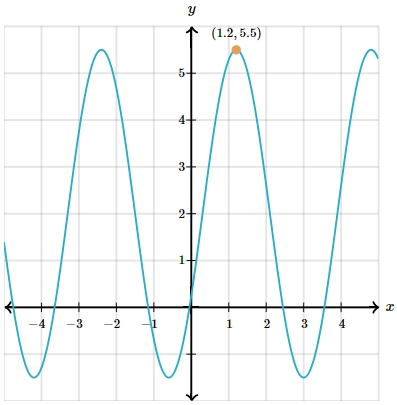
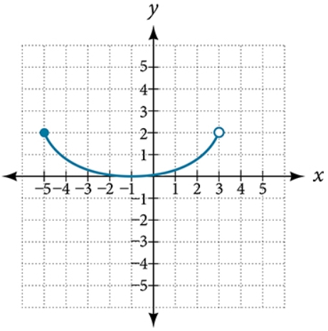

# AVP1526 — Single visual target

MathVerse:531 / MathVerse:484 · same type · Mathematical roles of graphical elements

## Shared or similar visual information

A filled circular point marker.

## Evidence locations

- Left image: The orange point labeled (1.2, 5.5) at the curve’s peak.
- Right image: The filled cyan point at (−5, 2), where the curve ends on the left.

## Mathematical meanings

Left image: The dot highlights a particular maximum on the continuing function curve. Right image: The dot includes the left endpoint (−5, 2) in the function graph.

## Same mathematical meanings

no

## Rationales

The feature identifies a specific point on the interior of the continuing graph in the left image and marks an endpoint included in the plotted branch in the right image. The orange point labeled (1.2, 5.5) at the curve’s peak. The filled cyan point at (−5, 2), where the curve ends on the left.

Only the selected target is annotated. AI visual-review draft; not independently double-annotated by humans.
