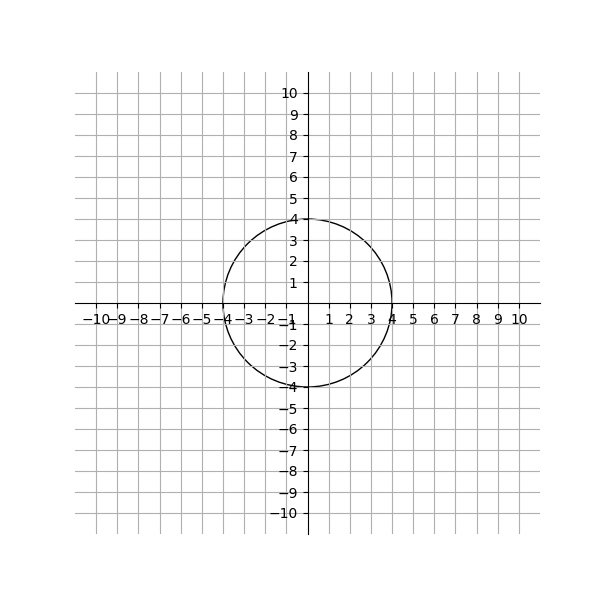

# AVP1529 — Single visual target

DynaMath:213 / VisioMath:107_A · different type · Mathematical roles of graphical elements

[Right image in official archive](https://raw.githubusercontent.com/Nefefilibata/VisioMath/4a912153e110001da261917902e1d3cc163b7c6a/data/images.zip) · `images/107_A.jpg`

## Shared or similar visual information

The horizontal coordinate axis.

## Evidence locations

- Left image: The numbered horizontal line through the middle of the grid.
- Right image: The x-axis running through O and crossing the rising line.

## Mathematical meanings

Left image: The axis gives the horizontal coordinate in the plane containing the circle. Right image: The axis measures the horizontal coordinate in the plotted relationship.

## Same mathematical meanings

yes

## Rationales

In both images the feature measures the horizontal Cartesian coordinate. The numbered horizontal line through the middle of the grid. The x-axis running through O and crossing the rising line.

Only the selected target is annotated. AI visual-review draft; not independently double-annotated by humans.
