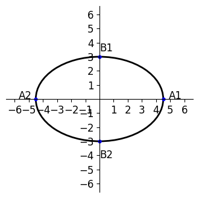

# AVP1533 — Single visual target

VisioMath:288_A / DynaMath:175 · different type · Mathematical roles of graphical elements

[Left image in official archive](https://raw.githubusercontent.com/Nefefilibata/VisioMath/4a912153e110001da261917902e1d3cc163b7c6a/data/images.zip) · `images/288_A.jpg`

## Shared or similar visual information

An oval drawn with an unbroken outline.

## Evidence locations

- Left image: The closed outline of the visible cylinder top.
- Right image: The closed curve through A1, A2, B1 and B2.

## Mathematical meanings

Left image: The oval represents the top circular rim of the cylinder projected into the drawing. Right image: The oval is the plotted ellipse with horizontal semiaxis 5 and vertical semiaxis 3.

## Same mathematical meanings

no

## Rationales

The feature shows a circular rim of a solid in perspective in the left image and traces a plane ellipse on the axes in the right image. The closed outline of the visible cylinder top. The closed curve through A1, A2, B1 and B2.

Only the selected target is annotated. AI visual-review draft; not independently double-annotated by humans.
