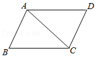

# AVP1536 — Single visual target

VisioMath:483_A / MathVista:179 · different type · Mathematical roles of graphical elements

[Left image in official archive](https://raw.githubusercontent.com/Nefefilibata/VisioMath/4a912153e110001da261917902e1d3cc163b7c6a/data/images.zip) · `images/483_A.jpg`

## Shared or similar visual information

A solid straight line descending from left to right.

## Evidence locations

- Left image: The straight line descending across the axes through a negative y-intercept.
- Right image: The downward sloping segment AC inside the parallelogram.

## Mathematical meanings

Left image: The line is the graph of a decreasing linear function. Right image: The segment is a diagonal between opposite vertices A and C.

## Same mathematical meanings

no

## Rationales

The feature plots a linear relationship between coordinates in the left image and connects opposite vertices of a quadrilateral in the right image. The straight line descending across the axes through a negative y-intercept. The downward sloping segment AC inside the parallelogram.

Only the selected target is annotated. AI visual-review draft; not independently double-annotated by humans.
