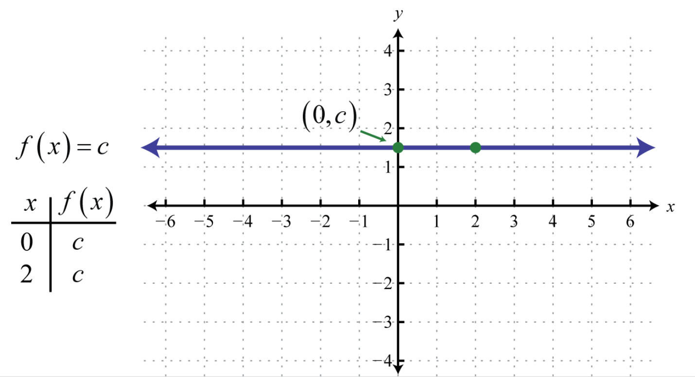
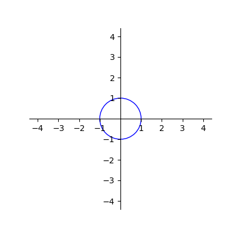

# AVP1537 — Single visual target

MathVista:223 / DynaMath:47 · different type · Mathematical roles of graphical elements

## Shared or similar visual information

The horizontal coordinate axis.

## Evidence locations

- Left image: The horizontal numbered axis through the leftmost marked point.
- Right image: The horizontal axis running through the blue unit circle.

## Mathematical meanings

Left image: The axis measures the input coordinate of the logarithmic plot. Right image: The axis gives the horizontal Cartesian coordinate.

## Same mathematical meanings

yes

## Rationales

In both images the feature measures the horizontal Cartesian coordinate. The horizontal numbered axis through the leftmost marked point. The horizontal axis running through the blue unit circle.

Only the selected target is annotated. AI visual-review draft; not independently double-annotated by humans.
