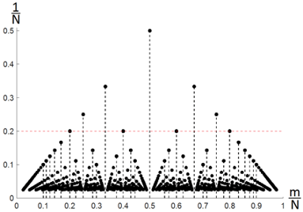

# AVP1539 — Single visual target

MathVista:738 / VisioMath:1338_A · different type · Mathematical roles of graphical elements

[Right image in official archive](https://raw.githubusercontent.com/Nefefilibata/VisioMath/4a912153e110001da261917902e1d3cc163b7c6a/data/images.zip) · `images/1338_A.jpg`

## Shared or similar visual information

A horizontal dashed line.

## Evidence locations

- Left image: The red dotted horizontal line through the 0.2 tick.
- Right image: The long horizontal dashed line at the rear of the cube’s bottom face.

## Mathematical meanings

Left image: The dotted line supplies a comparison level of 0.2 for the plotted points. Right image: The dashed horizontal line represents the hidden rear edge of the cube base.

## Same mathematical meanings

no

## Rationales

The feature marks a fixed output level for comparison in the left image and shows an occluded horizontal edge of a solid in the right image. The red dotted horizontal line through the 0.2 tick. The long horizontal dashed line at the rear of the cube’s bottom face.

Only the selected target is annotated. AI visual-review draft; not independently double-annotated by humans.
