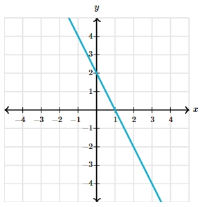

# AVP1541 — Single visual target

VisioMath:265_A / MathVerse:591 · same type · Mathematical roles of graphical elements

[Left image in official archive](https://raw.githubusercontent.com/Nefefilibata/VisioMath/4a912153e110001da261917902e1d3cc163b7c6a/data/images.zip) · `images/265_A.jpg`

## Shared or similar visual information

A solid straight line descending from left to right.

## Evidence locations

- Left image: The falling line crossing each axis at its mark labeled 1.
- Right image: The cyan falling line crossing the y-axis at 2 and x-axis at 1.

## Mathematical meanings

Left image: The straight trace graphs a negative-slope linear function. Right image: The straight trace plots a decreasing linear function.

## Same mathematical meanings

yes

## Rationales

In both images the feature plots a linear relationship between coordinates. The falling line crossing each axis at its mark labeled 1. The cyan falling line crossing the y-axis at 2 and x-axis at 1.

Only the selected target is annotated. AI visual-review draft; not independently double-annotated by humans.
