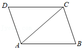
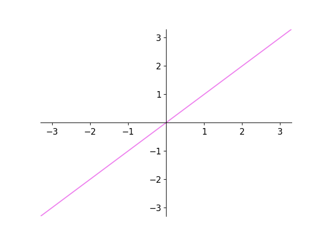

# AVP1542 — Single visual target

MathVista:32 / DynaMath:106 · different type · Mathematical roles of graphical elements

## Shared or similar visual information

A solid straight line rising from left to right.

## Evidence locations

- Left image: The rising straight segment from A to C inside ABCD.
- Right image: The magenta diagonal through the origin.

## Mathematical meanings

Left image: The segment is a diagonal connecting opposite vertices of the quadrilateral. Right image: The trace plots a directly proportional relationship, a linear function through the origin.

## Same mathematical meanings

no

## Rationales

The feature connects opposite vertices of a quadrilateral in the left image and plots a linear relationship between coordinates in the right image. The rising straight segment from A to C inside ABCD. The magenta diagonal through the origin.

Only the selected target is annotated. AI visual-review draft; not independently double-annotated by humans.
