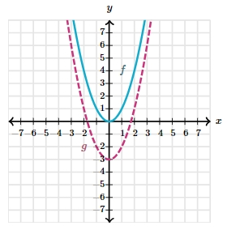

# AVP1546 — Single visual target

MathVerse:569 / VisioMath:616_A · different type · Mathematical roles of graphical elements

[Right image in official archive](https://raw.githubusercontent.com/Nefefilibata/VisioMath/4a912153e110001da261917902e1d3cc163b7c6a/data/images.zip) · `images/616_A.jpg`

## Shared or similar visual information

A dashed curve.

## Evidence locations

- Left image: The dashed magenta parabola labeled g, with its vertex below the origin.
- Right image: The dashed rear part of the lower ellipse of the upright cylinder.

## Mathematical meanings

Left image: The dashed trace is the graph of g. Right image: The dashed arc draws the occluded part of the cylinder’s lower circular rim.

## Same mathematical meanings

no

## Rationales

The feature plots the values of a function in the left image and shows the occluded part of the circular rim of a solid in the right image. The dashed magenta parabola labeled g, with its vertex below the origin. The dashed rear part of the lower ellipse of the upright cylinder.

Only the selected target is annotated. AI visual-review draft; not independently double-annotated by humans.
