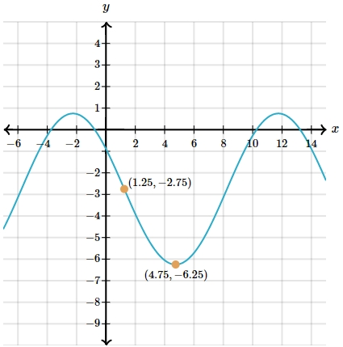
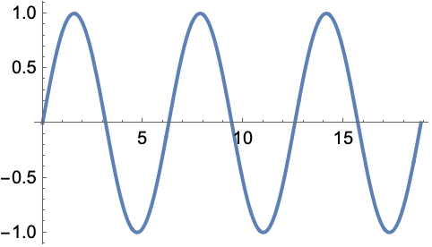

# AVP1547 — Single visual target

MathVerse:540 / MathVista:308 · same type · Mathematical roles of graphical elements

## Shared or similar visual information

A smooth oscillating curve.

## Evidence locations

- Left image: The cyan wave with the labeled trough (4.75, −6.25).
- Right image: The blue wave with regularly spaced peaks of height 1.

## Mathematical meanings

Left image: The line is a periodic graph, with the labeled coordinates fixing positions on its cycle. Right image: The trace is a periodic graph repeating its output pattern at regularly spaced x values.

## Same mathematical meanings

yes

## Rationales

In both images the feature traces a repeating function graph. The cyan wave with the labeled trough (4.75, −6.25). The blue wave with regularly spaced peaks of height 1.

Only the selected target is annotated. AI visual-review draft; not independently double-annotated by humans.
