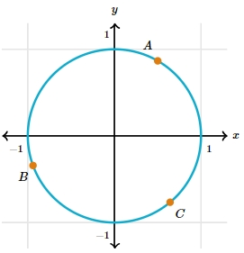

# AVP1548 — Single visual target

MathVerse:525 / VisioMath:1706_A · same type · Mathematical roles of graphical elements

[Right image in official archive](https://raw.githubusercontent.com/Nefefilibata/VisioMath/4a912153e110001da261917902e1d3cc163b7c6a/data/images.zip) · `images/1706_A.jpg`

## Shared or similar visual information

An unfilled circular outline.

## Evidence locations

- Left image: The cyan circle with A, B and C marked on it.
- Right image: The large circular outline through E, F and G.

## Mathematical meanings

Left image: The outline is the unit-circle circumference through the three marked points. Right image: The outline is the circumference containing E, F and G.

## Same mathematical meanings

yes

## Rationales

In both images the feature traces the circumference of a geometric circle. The cyan circle with A, B and C marked on it. The large circular outline through E, F and G.

Only the selected target is annotated. AI visual-review draft; not independently double-annotated by humans.
