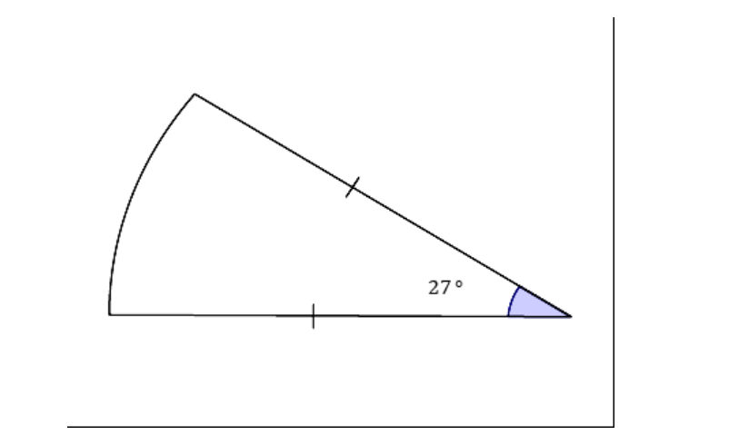
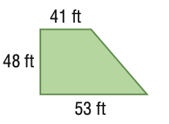

# AVP1549 — Single visual target

MathVerse:413 / MathVista:318 · same type · Mathematical roles of graphical elements

## Shared or similar visual information

A shaded region.

## Evidence locations

- Left image: The lavender wedge at the right-hand junction of the two radii.
- Right image: The pale green quadrilateral with bases labeled 41 ft and 53 ft.

## Mathematical meanings

Left image: The shading highlights the 27° central angle between the radii. Right image: The shading designates the interior area of the trapezoid.

## Same mathematical meanings

no

## Rationales

The feature highlights the angle between two rays in the left image and selects a geometric area in the right image. The lavender wedge at the right-hand junction of the two radii. The pale green quadrilateral with bases labeled 41 ft and 53 ft.

Only the selected target is annotated. AI visual-review draft; not independently double-annotated by humans.
