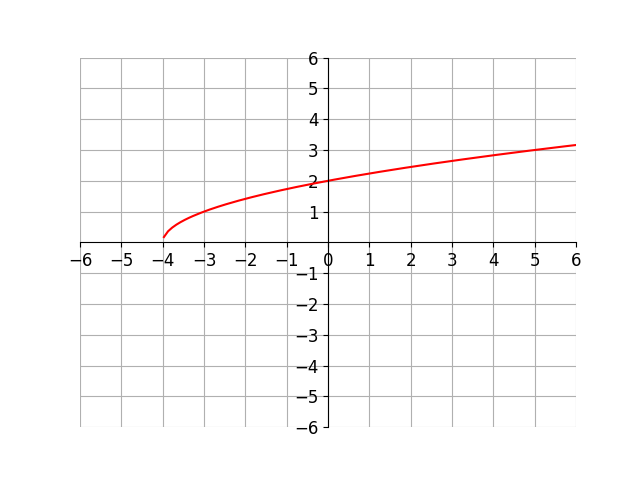

# AVP1550 — Single visual target

DynaMath:198 / MathVerse:556 · different type · Mathematical roles of graphical elements

## Shared or similar visual information

The horizontal coordinate axis.

## Evidence locations

- Left image: The numbered line below the red increasing curve.
- Right image: The x-axis crossing the middle of the unit circle.

## Mathematical meanings

Left image: The horizontal axis gives the input coordinate for the function graph. Right image: The axis measures the first coordinate of points, including the annotated circle point.

## Same mathematical meanings

yes

## Rationales

In both images the feature measures the horizontal Cartesian coordinate. The numbered line below the red increasing curve. The x-axis crossing the middle of the unit circle.

Only the selected target is annotated. AI visual-review draft; not independently double-annotated by humans.
