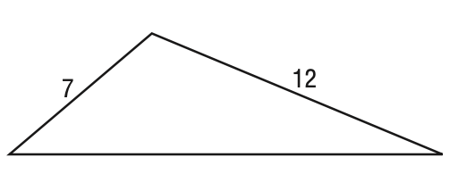

# AVP1551 — Single visual target

MathVista:615 / VisioMath:162_A · different type · Mathematical roles of graphical elements

[Right image in official archive](https://raw.githubusercontent.com/Nefefilibata/VisioMath/4a912153e110001da261917902e1d3cc163b7c6a/data/images.zip) · `images/162_A.jpg`

## Shared or similar visual information

A solid horizontal segment distinct from any axis or gridline.

## Evidence locations

- Left image: The unlabelled horizontal side of the triangular outline.
- Right image: The flat top joining the rising curve to the descending line.

## Mathematical meanings

Left image: The horizontal segment is the base of a triangle. Right image: The graph segment gives a time interval of constant S.

## Same mathematical meanings

no

## Rationales

The feature forms a horizontal side of a polygon in the left image and plots a constant function output over an interval in the right image. The unlabelled horizontal side of the triangular outline. The flat top joining the rising curve to the descending line.

Only the selected target is annotated. AI visual-review draft; not independently double-annotated by humans.
