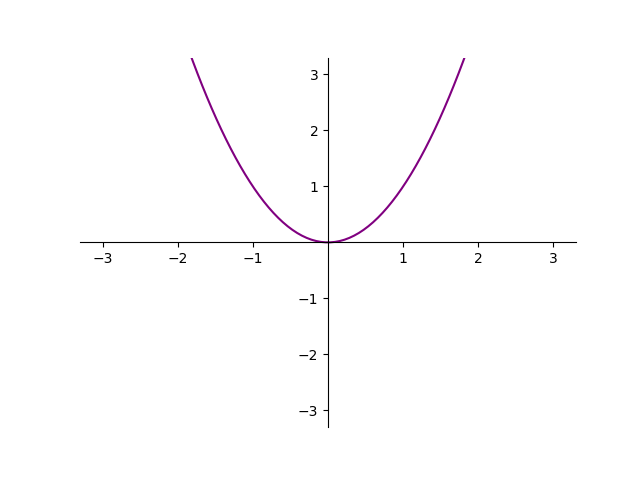
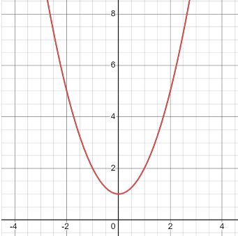

# AVP1552 — Single visual target

DynaMath:52 / MathVista:346 · same type · Mathematical roles of graphical elements

## Shared or similar visual information

A smooth U-shaped curve.

## Evidence locations

- Left image: The smooth purple U-shaped trace with vertex at the origin.
- Right image: The red U-shaped trace with its lowest point on the y-axis.

## Mathematical meanings

Left image: The curve plots a function with minimum at the origin. Right image: The curve plots a function with its minimum on the y-axis.

## Same mathematical meanings

yes

## Rationales

In both images the feature traces a function that reaches its lowest output at the bottom of the U. The smooth purple U-shaped trace with vertex at the origin. The red U-shaped trace with its lowest point on the y-axis.

Only the selected target is annotated. AI visual-review draft; not independently double-annotated by humans.
