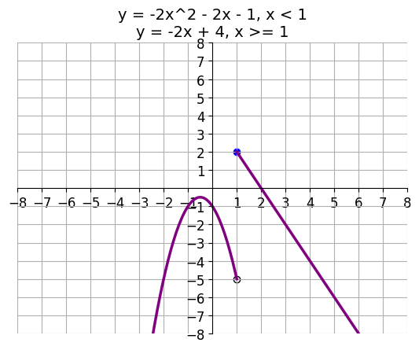

# AVP1553 — Single visual target

DynaMath:102 / DynaMath:87 · same type · Mathematical roles of graphical elements

## Shared or similar visual information

A filled circular point marker.

## Evidence locations

- Left image: The solid red point below the open point at x = 1.
- Right image: The filled purple point at (1, 2) starting the descending branch.

## Mathematical meanings

Left image: The dot specifies the actual red-graph function value at x = 1. Right image: The dot includes the initial point of the linear branch defined for x ≥ 1.

## Same mathematical meanings

no

## Rationales

The feature specifies an isolated included ordered pair off the nearby curve in the left image and marks an endpoint included in the plotted branch in the right image. The solid red point below the open point at x = 1. The filled purple point at (1, 2) starting the descending branch.

Only the selected target is annotated. AI visual-review draft; not independently double-annotated by humans.
