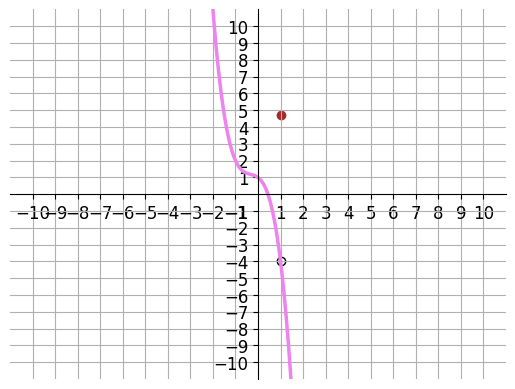

# AVP1557 — Single visual target

MathVerse:482 / DynaMath:143 · same type · Mathematical roles of graphical elements

## Shared or similar visual information

A filled circular point marker.

## Evidence locations

- Left image: The filled cyan point at (8, 6), at the right end of the trace.
- Right image: The filled red point at x = 1, above the hollow point on the curve.

## Mathematical meanings

Left image: The filled dot includes the coordinate (8, 6) at the end of the graph. Right image: The dot supplies the function value at the x-coordinate where the smooth trace has a hole.

## Same mathematical meanings

no

## Rationales

The feature marks an endpoint included in the plotted branch in the left image and specifies an isolated included ordered pair off the nearby curve in the right image. The filled cyan point at (8, 6), at the right end of the trace. The filled red point at x = 1, above the hollow point on the curve.

Only the selected target is annotated. AI visual-review draft; not independently double-annotated by humans.
