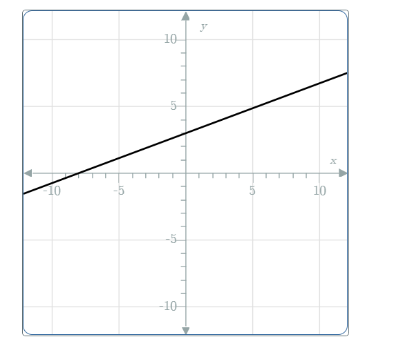

# AVP1558 — Single visual target

VisioMath:538_A / MathVerse:507 · same type · Mathematical roles of graphical elements

[Left image in official archive](https://raw.githubusercontent.com/Nefefilibata/VisioMath/4a912153e110001da261917902e1d3cc163b7c6a/data/images.zip) · `images/538_A.jpg`

## Shared or similar visual information

A solid straight line rising from left to right.

## Evidence locations

- Left image: The steep rising straight line through O.
- Right image: The black straight line crossing the axes and rising to the right.

## Mathematical meanings

Left image: The line plots a proportional relationship between the coordinates. Right image: The line is the graph of a positive-slope linear function.

## Same mathematical meanings

yes

## Rationales

In both images the feature plots a linear relationship between coordinates. The steep rising straight line through O. The black straight line crossing the axes and rising to the right.

Only the selected target is annotated. AI visual-review draft; not independently double-annotated by humans.
