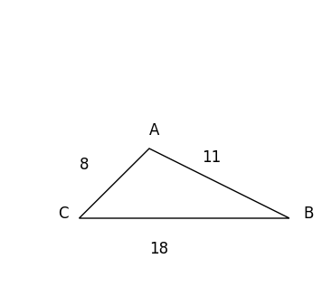

# AVP1559 — Single visual target

VisioMath:478_A / DynaMath:206 · different type · Mathematical roles of graphical elements

[Left image in official archive](https://raw.githubusercontent.com/Nefefilibata/VisioMath/4a912153e110001da261917902e1d3cc163b7c6a/data/images.zip) · `images/478_A.jpg`

## Shared or similar visual information

A solid horizontal segment distinct from any axis or gridline.

## Evidence locations

- Left image: The horizontal piece between the rising and falling parts of the plotted trace.
- Right image: The side from C to B labeled 18.

## Mathematical meanings

Left image: The horizontal piece plots constant S over a time interval. Right image: The horizontal segment is the base CB of the triangle.

## Same mathematical meanings

no

## Rationales

The feature plots a constant function output over an interval in the left image and forms a horizontal side of a polygon in the right image. The horizontal piece between the rising and falling parts of the plotted trace. The side from C to B labeled 18.

Only the selected target is annotated. AI visual-review draft; not independently double-annotated by humans.
