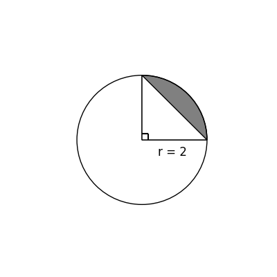

# AVP1561 — Single visual target

DynaMath:97 / MathVerse:512 · different type · Mathematical roles of graphical elements

## Shared or similar visual information

A shaded region.

## Evidence locations

- Left image: The dark segment enclosed by the chord and arc in the upper-right of the circle.
- Right image: The gray half-plane to the right of the falling dashed boundary.

## Mathematical meanings

Left image: The shading selects the area between the chord and its circular arc. Right image: The shaded half-plane is the solution region of a strict linear inequality.

## Same mathematical meanings

no

## Rationales

The feature selects a geometric area in the left image and selects the solution half-plane of a linear inequality in the right image. The dark segment enclosed by the chord and arc in the upper-right of the circle. The gray half-plane to the right of the falling dashed boundary.

Only the selected target is annotated. AI visual-review draft; not independently double-annotated by humans.
