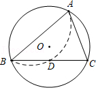

# AVP1564 — Single visual target

VisioMath:616_A / MathVista:700 · different type · Mathematical roles of graphical elements

[Left image in official archive](https://raw.githubusercontent.com/Nefefilibata/VisioMath/4a912153e110001da261917902e1d3cc163b7c6a/data/images.zip) · `images/616_A.jpg`

## Shared or similar visual information

A dashed curve.

## Evidence locations

- Left image: The dashed rear part of the lower ellipse of the upright cylinder.
- Right image: The dashed arc from B through D to A inside the circle.

## Mathematical meanings

Left image: The dashed arc draws the occluded part of the cylinder’s lower circular rim. Right image: The dashed trace is an auxiliary arc connecting points of the circle construction.

## Same mathematical meanings

no

## Rationales

The feature shows the occluded part of the circular rim of a solid in the left image and represents an auxiliary arc in a plane construction in the right image. The dashed rear part of the lower ellipse of the upright cylinder. The dashed arc from B through D to A inside the circle.

Only the selected target is annotated. AI visual-review draft; not independently double-annotated by humans.
