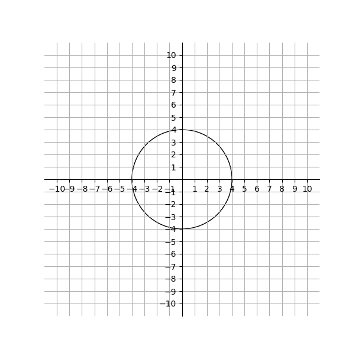

# AVP1567 — Single visual target

VisioMath:1187_A / DynaMath:213 · different type · Mathematical roles of graphical elements

[Left image in official archive](https://raw.githubusercontent.com/Nefefilibata/VisioMath/4a912153e110001da261917902e1d3cc163b7c6a/data/images.zip) · `images/1187_A.jpg`

## Shared or similar visual information

The horizontal coordinate axis.

## Evidence locations

- Left image: The x-axis labeled with −π and π.
- Right image: The numbered horizontal line through the middle of the grid.

## Mathematical meanings

Left image: The axis measures the horizontal Cartesian input to the curve. Right image: The axis gives the horizontal coordinate in the plane containing the circle.

## Same mathematical meanings

yes

## Rationales

In both images the feature measures the horizontal Cartesian coordinate. The x-axis labeled with −π and π. The numbered horizontal line through the middle of the grid.

Only the selected target is annotated. AI visual-review draft; not independently double-annotated by humans.
