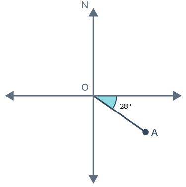

# AVP1568 — Single visual target

VisioMath:612_A / MathVerse:334 · same type · Mathematical roles of graphical elements

[Left image in official archive](https://raw.githubusercontent.com/Nefefilibata/VisioMath/4a912153e110001da261917902e1d3cc163b7c6a/data/images.zip) · `images/612_A.jpg`

## Shared or similar visual information

A shaded region.

## Evidence locations

- Left image: The dark triangular patch crossing the lines of the square assembly.
- Right image: The cyan wedge next to 28° at O.

## Mathematical meanings

Left image: The shading selects the area of the triangle drawn across the assembly. Right image: The shading highlights the angle from the rightward reference direction down to OA.

## Same mathematical meanings

no

## Rationales

The feature selects a geometric area in the left image and highlights the angle between two rays in the right image. The dark triangular patch crossing the lines of the square assembly. The cyan wedge next to 28° at O.

Only the selected target is annotated. AI visual-review draft; not independently double-annotated by humans.
